<div align="center">
  
</div>

<details>
<summary><b>▶ NOVO JOGO</b></summary>

<br>

```text
╔══════════════════════════════════════════════════════════════╗
║  Você acorda num laboratório da FIAP. Há cabos por todo lado, ║
║  um café pela metade e um terminal piscando.                  ║
║                                                               ║
║  Um estagiário de moletom verde vira a cadeira e diz:         ║
║                                                               ║
║  RAFAEL: "Ah, finalmente um visitante! O que você quer?"      ║
╚══════════════════════════════════════════════════════════════╝
```

<details>
<summary>&nbsp;&nbsp;&nbsp;➤ <b>"Quem é você?"</b></summary>

<br>

```text
RAFAEL: "Sou o Rafael Seiji, Engenheiro de Software em
         treinamento, LV 5. Faço estágio de TI aqui na FIAP:
         redes, laboratórios, infraestrutura... e tudo que
         se repete eu transformo em script Python ou PowerShell."
```

<details>
<summary>&nbsp;&nbsp;&nbsp;&nbsp;&nbsp;&nbsp;➤ <b>"Mostre sua ficha."</b></summary>

<br>


</details>

</details>

<details>
<summary>&nbsp;&nbsp;&nbsp;➤ <b>"Que tesouros você já conquistou?"</b></summary>

<br>

```text
╭─ INVENTÁRIO ─────────────────────────────────────────────╮
│                                                          │
│  [01] Troféu Dourado ........ 1º FIAP Hackathon 2026     │
│         └─ forjado com o projeto AUTO-LAB                │
│                                                          │
│  [02] Medalha de Prata ...... 2º FIAP NEXT 2026          │
│         └─ obtida na Iniciação Científica IRIS           │
│                                                          │
│  [03] Insígnia .............. Google Student Ambassador  │
│  [04] Chave de Fenda +1 ..... +1 ano de estágio em TI    │
│  [05] Café .................. x99 (consumível)           │
│                                                          │
╰──────────────────────────────────────────────────────────╯
```

</details>

<details>
<summary>&nbsp;&nbsp;&nbsp;➤ <b>"Você está procurando uma guilda?"</b></summary>

<br>

```text
RAFAEL: "Estou! Minha missão atual é encontrar uma equipe de
         BACKEND JAVA / SPRING BOOT, DEVOPS ou INFRA & CLOUD.
         Se for no setor financeiro, ganho bônus de XP."
```

<details>
<summary>&nbsp;&nbsp;&nbsp;&nbsp;&nbsp;&nbsp;➤ <b>"Minha empresa tem uma vaga."</b></summary>

<br>

```diff
+ ★ NOVO MEMBRO DESBLOQUEADO ★
+ Rafael Seiji quer entrar no seu grupo!
```

**[ ACEITAR ] → [linkedin.com/in/rafael-seiji](https://linkedin.com/in/rafael-seiji)**

</details>

<details>
<summary>&nbsp;&nbsp;&nbsp;&nbsp;&nbsp;&nbsp;➤ <b>"Hoje não, valeu."</b></summary>

<br>

```text
RAFAEL: "Tranquilo! Salvei seu progresso. Volte quando quiser. 💾"
```

</details>

</details>

<details>
<summary>&nbsp;&nbsp;&nbsp;➤ <b>Ir embora sem falar nada</b></summary>

<br>

```text
Você tenta sair, mas a porta do laboratório está trancada.
Um script em PowerShell automatizou o fechamento às 18h.

           ╔═══════════════════════╗
           ║      GAME  OVER       ║
           ╚═══════════════════════╝

          Recarregue a página para tentar de novo.
```

</details>

</details>

<br>

<div align="center">
<sub>© 2026 SEIJI GAMES · 1 PLAYER</sub><br>

